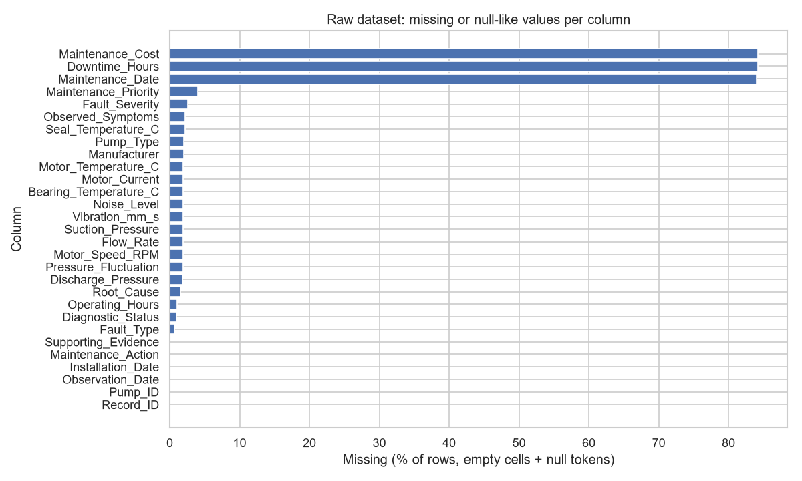
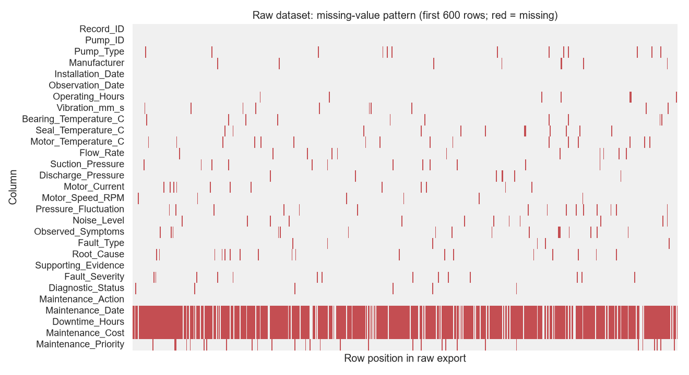

# Data Quality Report — RAW pump dataset

_Generated by `scripts/data_quality_analysis.py` from `data/raw/raw_pump_dataset.csv` only. The dataset is **synthetic** (see `dataset_description.md`)._

## 1. Shape and columns
- Rows: **7,354**  ·  Columns: **29**
- Unexpected columns: none; missing expected columns: none

## 2. Data types
`pandas_default_dtype` is what `pd.read_csv` infers with default settings. Numeric columns inferred as `object`/`str` contain non-numeric text (units, tokens, comma decimals).

| column | pandas_default_dtype | expected | distinct_values |
|---|---|---|---|
| Record_ID | str | text/category | 7246 |
| Pump_ID | str | text/category | 116 |
| Pump_Type | str | text/category | 21 |
| Manufacturer | str | text/category | 21 |
| Installation_Date | str | date | 170 |
| Observation_Date | str | date | 1540 |
| Operating_Hours | str | numeric | 6874 |
| Vibration_mm_s | str | numeric | 1088 |
| Bearing_Temperature_C | str | numeric | 676 |
| Seal_Temperature_C | str | numeric | 739 |
| Motor_Temperature_C | str | numeric | 528 |
| Flow_Rate | str | numeric | 2922 |
| Suction_Pressure | str | numeric | 333 |
| Discharge_Pressure | str | numeric | 1421 |
| Motor_Current | str | numeric | 1467 |
| Motor_Speed_RPM | str | numeric | 120 |
| Pressure_Fluctuation | str | numeric | 267 |
| Noise_Level | str | numeric | 267 |
| Observed_Symptoms | str | text/category | 500 |
| Fault_Type | str | text/category | 78 |
| Root_Cause | str | text/category | 41 |
| Supporting_Evidence | str | text/category | 2609 |
| Fault_Severity | str | text/category | 26 |
| Diagnostic_Status | str | text/category | 16 |
| Maintenance_Action | str | text/category | 36 |
| Maintenance_Date | str | date | 755 |
| Downtime_Hours | str | numeric | 333 |
| Maintenance_Cost | str | numeric | 1141 |
| Maintenance_Priority | str | text/category | 21 |

## 3. Missing values
**Caution:** in categorical columns some 'null-like' tokens are meaningful — `N/A`, `NA`, `-`, `0`, `none` in `Fault_Severity`/`Maintenance_Priority` mean *not applicable* (normal record), and `none`/`nil` in `Observed_Symptoms` mean *no abnormal symptoms*. They are variants, not missing data.

Empty cells and null-like tokens (`N/A`, `--`, `ERR`, `?`, `null`, `sensor fault`, `#VALUE!`) are counted. **Structural missingness:** `Maintenance_Date`, `Downtime_Hours` and `Maintenance_Cost` are legitimately empty for records with no maintenance event (`Maintenance_Action = No action required`), so their high missing rates are expected and must not be imputed.

| column | empty_cells | null_like_tokens | missing_total | missing_% |
|---|---|---|---|---|
| Maintenance_Cost | 6194 | 0 | 6194 | 84.23 |
| Downtime_Hours | 6193 | 0 | 6193 | 84.21 |
| Maintenance_Date | 6176 | 0 | 6176 | 83.98 |
| Maintenance_Priority | 147 | 145 | 292 | 3.97 |
| Fault_Severity | 108 | 84 | 192 | 2.61 |
| Observed_Symptoms | 110 | 51 | 161 | 2.19 |
| Seal_Temperature_C | 131 | 29 | 160 | 2.18 |
| Pump_Type | 150 | 0 | 150 | 2.04 |
| Manufacturer | 147 | 0 | 147 | 2.00 |
| Motor_Temperature_C | 113 | 30 | 143 | 1.94 |
| Motor_Current | 113 | 29 | 142 | 1.93 |
| Flow_Rate | 110 | 29 | 139 | 1.89 |
| Bearing_Temperature_C | 110 | 29 | 139 | 1.89 |
| Suction_Pressure | 109 | 30 | 139 | 1.89 |
| Vibration_mm_s | 110 | 29 | 139 | 1.89 |
| Noise_Level | 110 | 29 | 139 | 1.89 |
| Motor_Speed_RPM | 110 | 28 | 138 | 1.88 |
| Pressure_Fluctuation | 109 | 29 | 138 | 1.88 |
| Discharge_Pressure | 108 | 29 | 137 | 1.86 |
| Root_Cause | 111 | 0 | 111 | 1.51 |
| Operating_Hours | 76 | 0 | 76 | 1.03 |
| Diagnostic_Status | 73 | 0 | 73 | 0.99 |
| Fault_Type | 52 | 0 | 52 | 0.71 |
| Pump_ID | 0 | 0 | 0 | 0.00 |
| Installation_Date | 0 | 0 | 0 | 0.00 |
| Observation_Date | 0 | 0 | 0 | 0.00 |
| Record_ID | 0 | 0 | 0 | 0.00 |
| Maintenance_Action | 0 | 0 | 0 | 0.00 |
| Supporting_Evidence | 0 | 0 | 0 | 0.00 |

- Records with no maintenance event: **6,176**

## 4. Duplicates

| check | count |
|---|---|
| rows | 7354 |
| exact_duplicate_rows (all copies) | 216 |
| exact_duplicate_rows (redundant copies) | 108 |
| duplicate Record_IDs | 108 |
| same pump + same observation date, not exact copies | 71 |

Example partial duplicates (same pump and date after normalising ID/date formats):

| Record_ID | Pump_ID | Observation_Date | Vibration_mm_s | Fault_Type |
|---|---|---|---|---|
| R-900011 | P-001 | 11/01/2024 | 1.99 | NORMAL |
| R-000063 | P-001 | 2024-01-11 | 1.99 | Normal |
| R-000214 | P-002 | 17-Aug-2023 | 3.78 | Pump Blockage |
| R-900032 | P-002 | 2023/08/17 | 3.78 | PUMP BLOCKAGE |
| R-000661 | P-004 | 2025-01-29 | 1.78 | Normal |
| R-900014 | P-004 | 20250129 | 1.78 | NORMAL |

## 5. Value formats in numeric columns

| column | plain number | number + unit text | empty | thousands separator | comma decimal | null-like token | currency prefix | non_numeric_examples |
|---|---|---|---|---|---|---|---|---|
| Operating_Hours | 7133 | 91 | 76 | 54 | 0 | 0 | 0 | number + unit text: ['7822 h', '6424 hrs', '8113 h']; thousands separator: ['8,653', '34,963', '16,388'] |
| Vibration_mm_s | 7180 | 0 | 110 | 0 | 35 | 29 | 0 | comma decimal: ['1,85', '1,89', '1,69']; null-like token: ['ERR', 'sensor fault', '?'] |
| Bearing_Temperature_C | 7074 | 106 | 110 | 0 | 35 | 29 | 0 | number + unit text: ['130.3 °F', '181.4 °F', '147.4 degF']; comma decimal: ['46,0', '50,5', '52,3']; null-like token: ['#VALUE!', 'sensor fault', 'null'] |
| Seal_Temperature_C | 7050 | 108 | 131 | 0 | 36 | 29 | 0 | number + unit text: ['118.0 degF', '169.9F', '115.2 °F']; comma decimal: ['46,9', '43,0', '50,0']; null-like token: ['--', '?', '?'] |
| Motor_Temperature_C | 7070 | 108 | 113 | 0 | 33 | 30 | 0 | number + unit text: ['161.6 degF', '150.4 degF', '221.5 degF']; comma decimal: ['64,8', '69,6', '59,5']; null-like token: ['null', 'sensor fault', '?'] |
| Flow_Rate | 7071 | 107 | 110 | 0 | 37 | 29 | 0 | number + unit text: ['634 gpm', '24.4 L/s', '553 gpm']; comma decimal: ['98,1', '51,4', '154,4']; null-like token: ['N/A', 'null', '--'] |
| Suction_Pressure | 7067 | 112 | 109 | 0 | 36 | 30 | 0 | number + unit text: ['152 kPa', '17.5 psi', '12.9 psi']; comma decimal: ['1,56', '1,4', '1,85']; null-like token: ['?', '#VALUE!', '?'] |
| Discharge_Pressure | 7073 | 109 | 108 | 0 | 35 | 29 | 0 | number + unit text: ['106.3 psi', '1246 kPa', '128.5 psi']; comma decimal: ['7,36', '8,04', '6,51']; null-like token: ['N/A', 'ERR', '#VALUE!'] |
| Motor_Current | 7176 | 0 | 113 | 0 | 36 | 29 | 0 | comma decimal: ['58,7', '29,5', '78,7']; null-like token: ['#VALUE!', 'null', '--'] |
| Motor_Speed_RPM | 7216 | 0 | 110 | 0 | 0 | 28 | 0 | null-like token: ['--', 'ERR', 'null'] |
| Pressure_Fluctuation | 7181 | 0 | 109 | 0 | 35 | 29 | 0 | comma decimal: ['1,2', '2,4', '0,7']; null-like token: ['sensor fault', '--', 'sensor fault'] |
| Noise_Level | 7180 | 0 | 110 | 0 | 35 | 29 | 0 | comma decimal: ['75,7', '79,6', '79,0']; null-like token: ['?', 'null', '?'] |
| Downtime_Hours | 1104 | 57 | 6193 | 0 | 0 | 0 | 0 | number + unit text: ['5.8 hrs', '25.0 hrs', '10.9 hrs'] |
| Maintenance_Cost | 1067 | 0 | 6194 | 0 | 0 | 0 | 93 | currency prefix: ['$5,127.35', '$10,297.63', '$4,894.91'] |

## 6. Statistical summary (values that parse as numbers only)

| column | unit | parseable | mean | std | min | median | max |
|---|---|---|---|---|---|---|---|
| Operating_Hours | h | 7133 | 48228.96 | 22380.39 | 3806.00 | 45306.00 | 103189.00 |
| Vibration_mm_s | mm/s RMS | 7180 | 3.31 | 4.86 | 0.40 | 2.14 | 250.00 |
| Bearing_Temperature_C | °C | 7074 | 56.24 | 24.64 | 39.30 | 52.70 | 999.00 |
| Seal_Temperature_C | °C | 7050 | 51.88 | 12.07 | -99.00 | 48.80 | 129.40 |
| Motor_Temperature_C | °C | 7070 | 69.51 | 25.67 | 54.00 | 68.10 | 999.00 |
| Flow_Rate | m³/h | 7071 | 169.12 | 154.33 | -330.70 | 128.00 | 950.40 |
| Suction_Pressure | bar(a) | 7067 | 1.64 | 0.43 | 0.20 | 1.72 | 2.31 |
| Discharge_Pressure | bar(a) | 7073 | 9.56 | 118.86 | 0.49 | 7.09 | 9999.00 |
| Motor_Current | A | 7176 | 74.74 | 49.07 | 0.00 | 65.20 | 2112.00 |
| Motor_Speed_RPM | rpm | 7216 | 2074.45 | 806.25 | 1425.00 | 1477.00 | 29520.00 |
| Pressure_Fluctuation | % of mean | 7181 | 3.16 | 6.96 | 0.00 | 2.10 | 250.00 |
| Noise_Level | dB(A) | 7180 | 78.58 | 4.14 | 0.00 | 77.70 | 97.10 |
| Downtime_Hours | h | 1104 | 10.35 | 8.39 | 0.90 | 8.10 | 61.50 |
| Maintenance_Cost | USD | 1067 | 2694.05 | 2439.06 | 98.89 | 2175.77 | 22038.11 |

## 7. Outliers and implausible values
IQR fences (1.5×IQR) and robust z-score (median/MAD, |z|>3.5) are computed on parseable values. Because ~40% of records are not labelled normal, many statistical outliers are expected to be **genuine abnormal operation**, not errors. Physically implausible values (outside the limits in `common.PLAUSIBLE`) are a different category: they cannot be real.

| column | IQR_fence_low | IQR_fence_high | IQR_outliers | robust_z_gt_3.5 | plausible_range | physically_implausible |
|---|---|---|---|---|---|---|
| Operating_Hours | -19446.50 | 117509.50 | 0 | 0 | 0 – 200000 | 0 |
| Vibration_mm_s | -1.91 | 7.66 | 564 | 1237 | 0.05 – 50 | 2 |
| Bearing_Temperature_C | 40.65 | 65.85 | 854 | 780 | -10 – 150 | 4 |
| Seal_Temperature_C | 37.55 | 60.35 | 816 | 753 | -10 – 200 | 2 |
| Motor_Temperature_C | 57.15 | 79.15 | 230 | 183 | -10 – 180 | 5 |
| Flow_Rate | -45.40 | 308.60 | 790 | 589 | 0 – 2000 | 4 |
| Suction_Pressure | 0.48 | 2.88 | 174 | 26 | 0.01 – 10 | 0 |
| Discharge_Pressure | 2.43 | 11.84 | 1117 | 933 | 0.01 – 60 | 1 |
| Motor_Current | -14.10 | 151.70 | 509 | 392 | 0.5 – 400 | 8 |
| Motor_Speed_RPM | -739.00 | 5165.00 | 2 | 3014 | 300 – 3600 | 2 |
| Pressure_Fluctuation | -0.05 | 4.35 | 622 | 619 | 0 – 100 | 4 |
| Noise_Level | 70.26 | 85.56 | 601 | 399 | 30 – 130 | 2 |
| Downtime_Hours | -7.95 | 26.05 | 70 | 52 | 0 – 2000 | 0 |
| Maintenance_Cost | -3434.07 | 7919.35 | 49 | 29 | 0 – 500000 | 0 |

Outliers split by the (raw) fault label:

| column | pooled IQR: fault/unknown recs | pooled IQR: 'normal' recs | per-pump scaled IQR: 'normal' recs | implausible (any record) |
|---|---|---|---|---|
| Vibration_mm_s | 555 | 9 | 9 | 2 |
| Bearing_Temperature_C | 847 | 3 | 2 | 4 |
| Seal_Temperature_C | 808 | 6 | 6 | 2 |
| Motor_Current | 176 | 328 | 7 | 8 |
| Motor_Speed_RPM | 0 | 0 | 62 | 2 |
| Pressure_Fluctuation | 608 | 10 | 11 | 4 |

Interpretation: for vibration, temperatures and pressure fluctuation almost all outliers sit in fault records, i.e. they are genuine abnormal operation. Pooled `Motor_Current` and `Motor_Speed_RPM` outliers in 'normal' records are an artefact of mixing pump sizes (rated current 20–250 A) and two synchronous speeds (≈1475 / ≈2950 rpm); scaling current by its pump's median removes almost all of them. Speed is nearly constant within a pump (±0.3%), so after scaling the IQR becomes so narrow that trivial deviations are flagged — IQR is not a meaningful test for near-constant signals; a ±5% band around rated speed is used instead in cleaning. The few remaining 'normal' outliers after scaling are the genuinely suspicious values (possible entry errors such as decimal shifts) and are flagged — not deleted — during cleaning.

## 8. Date formats

| column | ISO YYYY-MM-DD | DD-Mon-YYYY | YYYYMMDD | YYYY/MM/DD | DD/MM/YYYY | empty |
|---|---|---|---|---|---|---|
| Installation_Date | 7061 | 94 | 70 | 65 | 64 | 0.00 |
| Observation_Date | 6883 | 100 | 120 | 118 | 133 | 0.00 |
| Maintenance_Date | 1108 | 23 | 18 | 12 | 17 | 6176.00 |

`DD/MM/YYYY` is assumed (not `MM/DD`) — documented site convention; see cleaning report.

## 9. Categorical inconsistencies
### Pump_ID

| variants | n_variants | n |
|---|---|---|
| 'P-023' · 'p023' | 2 | 192 |
| 'P-034' · 'p034' | 2 | 190 |
| 'P-014' · 'P-014 ' | 2 | 187 |
| 'P-015' · 'p015' | 2 | 187 |
| 'P-038' · 'P-038 ' | 2 | 187 |
| 'P-002' · 'p002' | 2 | 186 |
| 'P-037' | 1 | 186 |
| 'P-008' · 'P-008 ' · 'p008' | 3 | 186 |
| 'P-012' | 1 | 186 |
| 'P-030' · 'P-030 ' | 2 | 185 |
| 'P-010' · 'P-010 ' · 'p010' | 3 | 185 |
| 'P-009' · 'p009' | 2 | 185 |
| 'P-036' · 'P-036 ' · 'p036' | 3 | 185 |
| 'P-033' | 1 | 185 |

### Pump_Type

| variants | n_variants | n |
|---|---|---|
| 'END SUCTION' · 'End Suction' · 'End-Suction' · 'Endsuction' · 'end suction' | 5 | 3577 |
| 'VERTICAL INLINE' · 'Vertical In-line' · 'Vertical Inline' · 'vertical inline' | 4 | 1262 |
| 'SPLIT CASE' · 'Split Case' · 'Split-case' · 'split case' | 4 | 1256 |
| 'MULTISTAGE' · 'Multi Stage' · 'Multi-stage' · 'Multistage' · 'multistage' | 5 | 1091 |
| '' | 1 | 150 |
| 'Inline' | 1 | 11 |
| 'Horizontal split case' | 1 | 7 |

### Manufacturer

| variants | n_variants | n |
|---|---|---|
| 'VENDOR C' · 'Vendor C' · 'Vendor C.' · 'VendorC' · 'vendor c' | 5 | 2161 |
| 'VENDOR D' · 'Vendor D' · 'Vendor D.' · 'VendorD' · 'vendor d' | 5 | 1791 |
| 'VENDOR B' · 'Vendor B' · 'Vendor B.' · 'VendorB' · 'vendor b' | 5 | 1637 |
| 'VENDOR A' · 'Vendor A' · 'Vendor A.' · 'VendorA' · 'vendor a' | 5 | 1618 |
| '' | 1 | 147 |

### Fault_Type

| variants | n_variants | n |
|---|---|---|
| 'NORMAL' · 'Normal' · 'normal' | 3 | 4431 |
| 'BEARING FAILURE' · 'Bearing Failure' · 'Bearing Failure ' · 'bearing failure' | 4 | 645 |
| 'MECHANICAL SEAL LEAKAGE' · 'Mechanical Seal Leakage' | 2 | 562 |
| 'IMPELLER DAMAGE' · 'Impeller Damage' · 'impeller damage' | 3 | 265 |
| ' Cavitation' · 'CAVITATION' · 'Cavitation' · 'cavitation' | 4 | 243 |
| 'SHAFT MISALIGNMENT' · 'Shaft Misalignment' · 'Shaft mis-alignment' · 'shaft misalignment' | 4 | 198 |
| 'DISCHARGE RESTRICTION' · 'Discharge Restriction' · 'discharge restriction' | 3 | 157 |
| 'MOTOR FAULT' · 'Motor Fault' · 'motor fault' | 3 | 156 |
| 'AIR INGRESS' · 'Air Ingress' · 'air ingress' | 3 | 151 |
| 'PUMP BLOCKAGE' · 'Pump Blockage' · 'pump blockage' | 3 | 148 |
| 'Dry Running' · 'Dry-running' | 2 | 67 |
| 'UNKNOWN' · 'Unknown' · 'unknown' | 3 | 59 |
| '' | 1 | 52 |
| 'Seal Leak' | 1 | 26 |
| 'Brg failure' | 1 | 16 |
| 'MISALIGNMENT' · 'Misalignment' | 2 | 15 |
| 'Bearing fault' | 1 | 12 |
| 'Seal leakage' | 1 | 11 |
| 'mech. seal leakage' | 1 | 10 |
| 'Mechancal Seal Leakage' | 1 | 10 |
| 'unk' | 1 | 9 |
| 'RESTRICTED DISCHARGE' · 'Restricted discharge' | 2 | 8 |
| 'OK' | 1 | 7 |
| 'Clogged pump' | 1 | 7 |
| 'N.D.' | 1 | 7 |
| 'Bearing Faliure' | 1 | 6 |
| 'Blockage' | 1 | 6 |
| 'Motor failure' | 1 | 6 |
| 'Cavitaton' | 1 | 6 |
| 'Air leak (suction)' | 1 | 5 |
| 'Impeller Damge' | 1 | 5 |
| 'TBD' | 1 | 4 |
| 'Bearng Failure' | 1 | 4 |
| 'Normal operation' | 1 | 4 |
| 'MECHANICAL SEAL LEAKGE' · 'Mechanical Seal Leakge' | 2 | 4 |
| 'Impeller damaged' | 1 | 4 |
| 'Electrical motor fault' | 1 | 4 |
| 'Air Ingrees' | 1 | 3 |
| 'DRY RUN' · 'Dry run' | 2 | 3 |
| 'Air Ingres' | 1 | 2 |

### Root_Cause

| variants | n_variants | n |
|---|---|---|
| 'Not Applicable' | 1 | 4472 |
| 'Under investigation' | 1 | 846 |
| 'Overload from shaft misalignment' | 1 | 144 |
| 'Bearing fatigue (end of life)' | 1 | 120 |
| 'Contaminated lubricant' | 1 | 118 |
| 'Elastomer degradation' | 1 | 116 |
| '' | 1 | 111 |
| 'Seal flush failure' | 1 | 111 |
| 'Seal face wear' | 1 | 95 |
| 'Excessive shaft vibration' | 1 | 85 |
| 'Lubrication deficiency' | 1 | 82 |
| 'Unknown' | 1 | 82 |
| 'Foreign object impact' | 1 | 50 |
| 'Operation far right of best efficiency point' | 1 | 50 |

### Fault_Severity

| variants | n_variants | n |
|---|---|---|
| 'No Fault' · 'no fault' | 2 | 4266 |
| 'Medium' · 'medium' | 2 | 1088 |
| 'HIGH' · 'High' · 'high' | 3 | 727 |
| 'LOW' · 'Low' · 'low' | 3 | 675 |
| 'Critical' · 'critical' | 2 | 277 |
| '' | 1 | 108 |
| '0' | 1 | 55 |
| 'N/A' | 1 | 44 |
| 'none' | 1 | 40 |
| '2' | 1 | 13 |
| 'L' | 1 | 12 |
| 'Med' | 1 | 12 |
| 'M' | 1 | 9 |
| '3' | 1 | 8 |

### Diagnostic_Status

| variants | n_variants | n |
|---|---|---|
| 'No Fault Detected' | 1 | 4300 |
| 'Suspected' · 'suspected' | 2 | 1709 |
| 'Confirmed' · 'confirmed' | 2 | 998 |
| 'Inconclusive' | 1 | 79 |
| '' | 1 | 73 |
| 'NFD' | 1 | 49 |
| 'Healthy' | 1 | 48 |
| 'no fault' | 1 | 31 |
| 'Susp.' | 1 | 19 |
| 'CONF' | 1 | 17 |
| 'Confirmed by inspection' | 1 | 15 |
| 'Possible' | 1 | 14 |
| 'Pending' | 1 | 1 |
| 'Unclear' | 1 | 1 |

### Maintenance_Action

| variants | n_variants | n |
|---|---|---|
| 'NO ACTION REQUIRED' · 'No action required' · 'no action required' | 3 | 6176 |
| 'Replace bearings and renew lubrication' · 'replace bearings and renew lubrication' | 2 | 258 |
| 'REPLACE MECHANICAL SEAL' · 'Replace mechanical seal' · 'replace mechanical seal' | 3 | 223 |
| 'ROUTINE PREVENTIVE MAINTENANCE' · 'Routine preventive maintenance' | 2 | 113 |
| 'REPAIR OR REPLACE IMPELLER' · 'Repair or replace impeller' · 'repair or replace impeller' | 3 | 103 |
| 'RESTORE SUCTION CONDITIONS AND CLEAN STRAINER' · 'Restore suction conditions and clean strainer' · 'restore suction conditions and clean strainer' | 3 | 86 |
| 'Laser realign pump and motor shafts' · 'laser realign pump and motor shafts' | 2 | 78 |
| 'Inspect motor and correct electrical fault' · 'inspect motor and correct electrical fault' | 2 | 65 |
| 'SEAL SUCTION-SIDE LEAKS AND RE-PRIME' · 'Seal suction-side leaks and re-prime' · 'seal suction-side leaks and re-prime' | 3 | 58 |
| 'Open or repair discharge valve and clear line' · 'open or repair discharge valve and clear line' | 2 | 57 |
| 'Stop pump, restore liquid supply and re-prime' | 1 | 51 |
| 'Clear blockage and clean impeller and strainer' · 'clear blockage and clean impeller and strainer' | 2 | 47 |
| 'Further investigation scheduled' · 'further investigation scheduled' | 2 | 29 |
| 'Restore suction conditions & clean strainer' | 1 | 3 |

### Maintenance_Priority

| variants | n_variants | n |
|---|---|---|
| 'Not Applicable' | 1 | 4128 |
| 'P3 - Medium' | 1 | 1086 |
| 'P4 - Low' | 1 | 777 |
| 'P2 - High' | 1 | 655 |
| 'P1 - Emergency' | 1 | 337 |
| '' · '-' | 2 | 193 |
| 'NA' · 'n/a' | 2 | 99 |
| 'Priority 3' | 1 | 16 |
| 'low' | 1 | 9 |
| 'medium' | 1 | 9 |
| 'P4' | 1 | 8 |
| 'P3' | 1 | 7 |
| 'Priority 4' | 1 | 7 |
| 'high' | 1 | 5 |

## 10. Free-text: Observed_Symptoms

| separator | rows |
|---|---|
| '; ' | 1550 |
| ', ' | 40 |
| ' \| ' | 29 |
| ' / ' | 47 |
| ' and ' | 44 |

Distinct symptom tokens after naive splitting: **71** (canonical vocabulary has 20 + 'no abnormal symptoms').

| token | count |
|---|---|
| no abnormal symptoms | 4172 |
| high vibration | 1344 |
| low flow | 590 |
| visible seal leakage | 470 |
| grinding noise | 459 |
| pressure fluctuating | 362 |
| coupling vibration | 322 |
| high bearing temperature | 310 |
| low suction pressure | 282 |
| high seal temperature | 281 |
| high noise level | 275 |
| low discharge pressure | 191 |
| crackling noise | 169 |
| high discharge pressure | 150 |
| rapid temperature rise | 145 |
| air bubbles in discharge | 113 |
| high motor temperature | 105 |
| motor speed unstable | 96 |
| loss of prime | 89 |
| no flow | 86 |
| none | 84 |
| normal | 81 |
| nil | 80 |
| no issues | 66 |
| high motor current | 58 |
| vibration high | 49 |
| excessive vibration | 27 |
| high vib | 25 |
| grinding sound | 22 |
| leak at seal | 20 |
| reduced flow | 15 |
| pressure fluctuation | 13 |
| seal hot | 12 |
| brg temp high | 12 |
| high bearing temp | 12 |
| pressure surging | 12 |
| seal leaking | 11 |
| suction pressure low | 11 |
| seal leak | 10 |
| seal temp high | 10 |

## 11. Key findings to address in cleaning
1. Numeric columns stored as text because of unit suffixes (°F, psi, kPa, gpm, L/s, hrs, $), comma decimals, thousands separators and error tokens.
2. Exact duplicate rows and re-keyed partial duplicates (same pump/date, different Record_ID).
3. Five date formats across three date columns.
4. Many spellings of the same category (case, punctuation, abbreviations, typos) — including fault labels and several ways of writing 'unknown'.
5. Physically impossible sentinel values (999, 9999, negative pressure/flow, zero current/noise).
6. Statistical outliers that are mostly explained by fault records and must be kept.
7. Missing equipment attributes that are recoverable from the asset register (Pump_ID is a key).
8. Missing diagnostic labels that are **not** recoverable and must not be guessed.